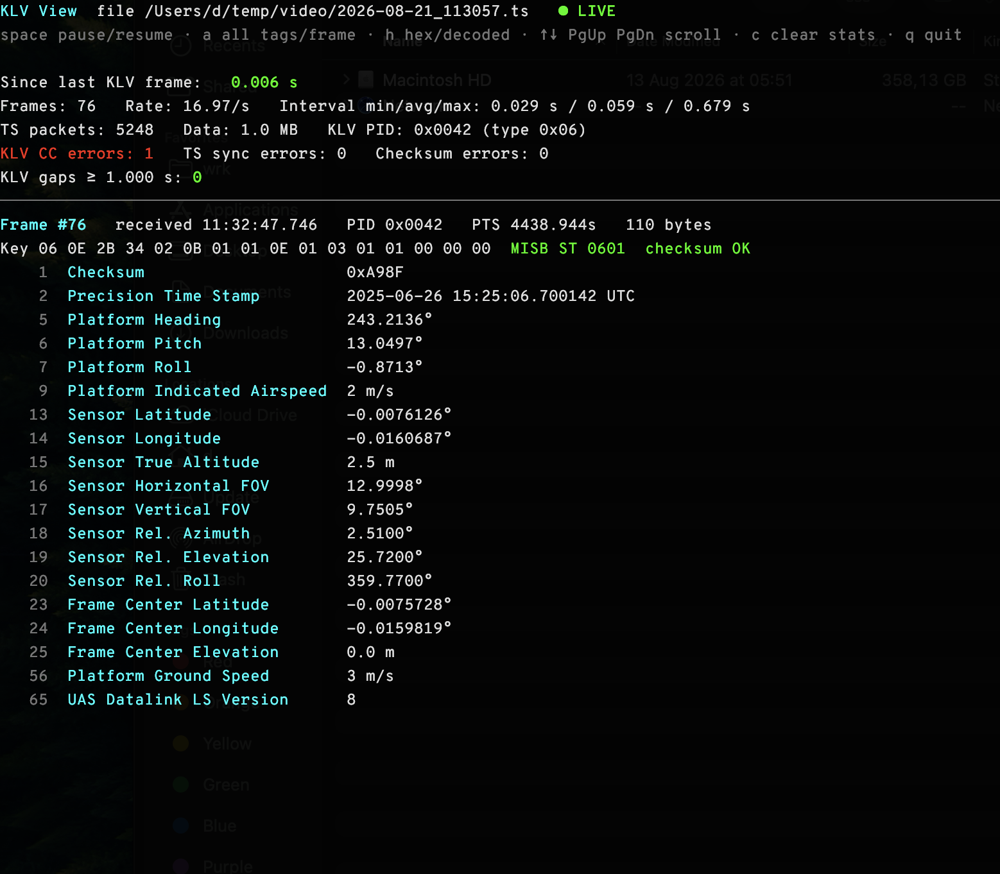

# klv-view

Terminal viewer for KLV metadata (MISB ST 0601) carried in an MPEG-TS stream.
It reads the TS directly from UDP multicast and needs no GStreamer. See `HANDOFF.md`
for the stream details.



- Demuxes TS (PAT/PMT), finds the KLV PID automatically:
  - `stream_type 0x15`: synchronous metadata, ST 1402 AU cells
  - `stream_type 0x06` + `KLVA` registration: asynchronous KLV
- Decodes the ST 0601 local set (tags 1–142) and verifies the checksum.
- Shows **time since the last KLV frame** live, flags `KLV MISSING`, and keeps a
  history of gaps (default threshold 1 s, `--gap` to change).
- Also counts KLV continuity-counter errors, TS sync errors and checksum failures.

## Build on Windows

Install Rust from https://rustup.rs (choose the default MSVC toolchain), then:

```powershell
cargo build --release
.\target\release\klv-view.exe                       # udp://227.1.1.1:15001
.\target\release\klv-view.exe --iface 192.168.1.50  # pick the NIC for multicast
```

On first run, allow `klv-view.exe` through Windows Firewall. If it's blocked,
multicast fails silently and you'll see `TS packets: 0`.

## Cross-compile from macOS/Linux

```bash
cargo install cargo-xwin
rustup target add x86_64-pc-windows-msvc
cargo xwin build --release --target x86_64-pc-windows-msvc
# -> target/x86_64-pc-windows-msvc/release/klv-view.exe
```

## Usage

```
klv-view [OPTIONS] [INPUT]

INPUT:    udp://GROUP:PORT | GROUP:PORT | path\to\file.ts
  -i, --iface IP     local interface IP for the multicast join
  -p, --pid PID      force the KLV PID (e.g. 0x101) instead of reading the PMT
  -g, --gap SECONDS  gap threshold (default 1.0)
  -s, --stale SECS   all-tags view: tags older than this are red (default 1.0)
      --fast         files: don't pace by PTS
      --loop         files: loop forever
```

Keys: `space` pause/resume, `a` all-tags-seen view or latest frame, `h` hex dump
or decoded view, `↑ ↓ PgUp PgDn Home` scroll, `c` clear gap history, counters and
seen tags, `q`/`Esc` quit.

The all-tags-seen view (`a`) lists every ST 0601 tag received so far in tag
order. Each row shows the tag's latest value and how long ago it was last
updated. Rows not updated for more than `--stale` seconds turn red. This
catches tags the encoder sends only some of the time, and tags that have
stopped arriving.

Pause behaviour: on a **live** stream, pausing freezes the displayed frame. Reception,
the "since last KLV" timer and gap detection keep running, and resuming jumps to the
newest frame. On a **file**, pausing stops playback, so the pause isn't counted as a gap.
